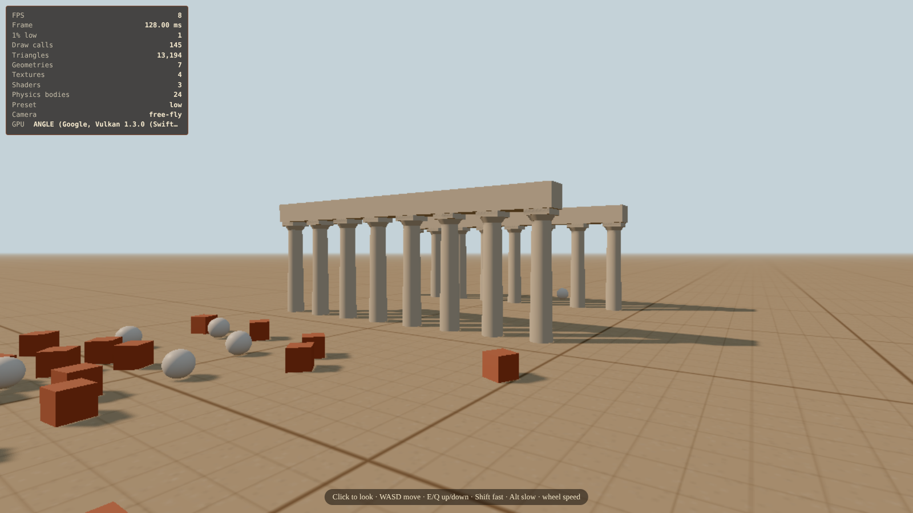

# Akademeia

A third-person 3D exploration and story game set at Plato's Academy, Athens, 367–335 BC. You arrive as a new student on
the same day as the 17-year-old Aristotle.

Built with TypeScript, three.js and Rapier. The design is in [`GAME_DESIGN.md`](GAME_DESIGN.md), and progress is in [`PROGRESS.md`](PROGRESS.md).

## Run it

You need [Node.js 22+](https://nodejs.org/).

```bash
npm install
npm run dev
```

Then open http://localhost:5173.

Controls (debug build): **F2** free-fly camera (click to look; WASD, E/Q, Shift, Alt, mouse wheel), **F3** stats, **R** re-drop props.

## Measure performance on your machine

Open http://localhost:5173/?bench, wait 20 seconds without touching anything, click **Copy result**, and paste it into the chat.
The report includes your GPU's name, so you don't need to look it up.


